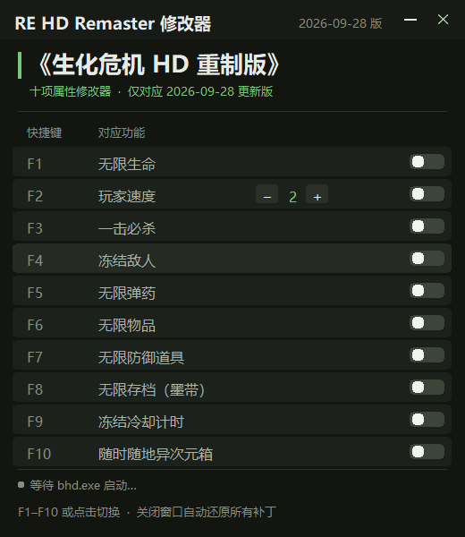

# RE HD Remaster Trainer (standalone)

**English** | [简体中文](README.md)

A small, single-file Windows trainer for **Resident Evil HD Remaster** (the 2026-09-28 game update, `bhd.exe` build `39b84066…`).



The trainer is an external process: it attaches to `bhd.exe`, verifies the game build, applies in-memory patches, and restores everything when you close it or when the game exits.

## Features

| Hotkey | Cheat | Notes |
| --- | --- | --- |
| `F1` | Unlimited Health | clamps player health writes |
| `F2` | Player Speed | 1–10×, adjustable with `− / +` |
| `F3` | One-Hit Kills | clamps enemy health |
| `F4` | Freeze Enemies | sets enemy movement speed to 0 |
| `F5` | Unlimited Ammo | no ammo consumption |
| `F6` | Unlimited Items | item quantity forced high |
| `F7` | Unlimited Defense Items | defense item counters forced high |
| `F8` | Unlimited Saves | ink ribbon quantity forced high |
| `F9` | Freeze Cooldown Timer | freezes an internal scene timer (no normal-play use) |
| `F10` | Item Box Anywhere | opening the inventory opens the item box instead |

- Click a row or press its hotkey to toggle. The switch and row highlight show the state.
- Toggle sounds play only when the game is attached and the patch was successfully applied.
- Closing the trainer (or the game exiting) removes all patches and turns every cheat off.
- The window is draggable; `—` minimizes, `✕` closes.
- If the game version does not match, the trainer refuses to attach instead of writing to unknown code.

## Build

Requirements:

- Rust (any recent stable `rustc`, tested with 1.97, `x86_64-pc-windows-gnu`)
- Windows 10/11

```bat
build.bat
```

or:

```sh
rustc -O src/main.rs -o REHDTrainer.exe -C strip=symbols
```

The build produces a single `REHDTrainer.exe` with no external runtime dependencies (system DLLs only).

### Assets

`assets/` contains the original placeholder icon and toggle sounds used by this public build. They are generated by `tools/make_assets.py` (Python + Pillow) and are released as CC0. Regenerate them with:

```sh
python tools/make_assets.py
```

The author's local build uses different sounds/icon that are third-party works and are intentionally **not** included in this repository.

## Usage

1. Start the game and load a save.
2. Run `REHDTrainer.exe` (run as administrator if the game runs elevated).
3. Wait for the status line to show the game PID.
4. Toggle cheats with the hotkeys or by clicking.
5. Close the trainer when done — patches are reverted automatically.

## Notes and limitations

- Built for the **2026-09-28** game update only. Other builds are rejected by the version check.
- Single-player only. Do not use in any online or anti-cheat protected context.
- No game files are included; the trainer only reads/writes process memory while it runs.
- Patches are applied to the running process only. Nothing is written to disk.
- If the trainer is force-killed while cheats are active, the game keeps the patches until it is restarted.

## Disclaimer

Unofficial fan tool. Not affiliated with or endorsed by Capcom, WeMod, FLiNG, or 3DM. Use at your own risk.

## License

Code: MIT (see `LICENSE`).  
Generated placeholder assets: CC0.
