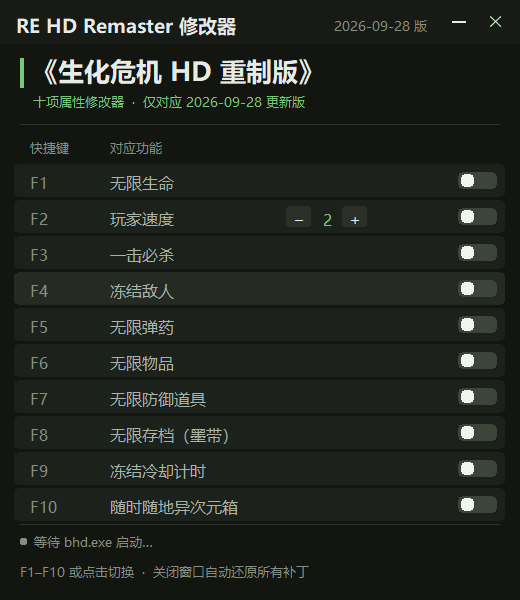

# RE HD Remaster 修改器（独立版）

[English](README.en.md) | **简体中文**

适用于 **《生化危机 HD 重制版》**（2026-09-28 游戏更新，`bhd.exe` 构建 `39b84066…`）的单文件 Windows 修改器。



修改器是一个独立进程：它附加到 `bhd.exe`，校验游戏版本后写入内存补丁；关闭修改器或游戏退出时会自动还原全部补丁。

## 功能

| 热键 | 功能 | 说明 |
| --- | --- | --- |
| `F1` | 无限生命 | 锁定玩家生命值写入 |
| `F2` | 玩家速度 | 1–10 倍，可用 `− / +` 调整 |
| `F3` | 一击必杀 | 敌方生命值压制为 1 |
| `F4` | 冻结敌人 | 敌人移动速度设为 0 |
| `F5` | 无限弹药 | 不消耗弹药 |
| `F6` | 无限物品 | 物品数量保持高位 |
| `F7` | 无限防御道具 | 防御道具计数保持高位 |
| `F8` | 无限存档 | 墨带数量保持高位 |
| `F9` | 冻结冷却计时 | 冻结内部场景计时器（正常流程基本用不到） |
| `F10` | 随时随地异次元箱 | 打开背包时改为打开异次元箱 |

- 点击行或按对应热键即可开关，开关和整行高亮表示当前状态。
- 只有游戏已连接且补丁成功写入时才会播放开关音效。
- 关闭修改器或游戏退出时，所有补丁会被撤销，所有开关自动关闭。
- 窗口可拖动，`—` 最小化，`✕` 关闭。
- 游戏版本不匹配时修改器会拒绝附加，不会向未知代码写入。

## 编译

环境要求：

- Rust（任意较新的 stable `rustc`，测试于 1.97，`x86_64-pc-windows-gnu`）
- Windows 10/11

```bat
build.bat
```

或：

```sh
rustc -O src/main.rs -o REHDTrainer.exe -C strip=symbols
```

产物是单个 `REHDTrainer.exe`，除系统 DLL 外无外部依赖。

### 素材说明

`assets/` 中是为公开版准备的自制占位图标与开关音效，由 `tools/make_assets.py`（Python + Pillow）生成，以 CC0 发布。重新生成：

```sh
python tools/make_assets.py
```

作者本地使用的图标/音效来自第三方作品，因此**未包含**在本仓库中。

## 使用

1. 启动游戏并读取存档。
2. 运行 `REHDTrainer.exe`（若游戏以管理员身份运行，修改器也需要）。
3. 等待状态栏显示游戏 PID。
4. 用热键或鼠标点击开关功能。
5. 使用完毕关闭修改器，补丁会自动还原。

## 注意事项

- 仅适配 **2026-09-28** 游戏更新；其他版本会被版本校验拒绝。
- 仅限单人模式使用，请勿用于任何联机或带反作弊的环境。
- 仓库不包含任何游戏文件；修改器只在运行时读写游戏进程内存。
- 补丁只作用于运行中的进程，不写入磁盘。
- 如果在功能开启时强制结束修改器，游戏会保留补丁直到重新启动。

## 免责声明

非官方爱好者工具，与 Capcom、WeMod、FLiNG、3DM 均无关联，也未获其认可。使用风险自负。

## 许可证

代码：MIT（见 `LICENSE`）。  
生成的占位素材：CC0。
